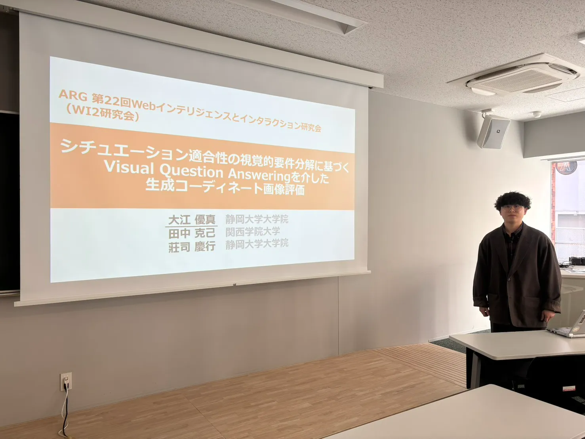
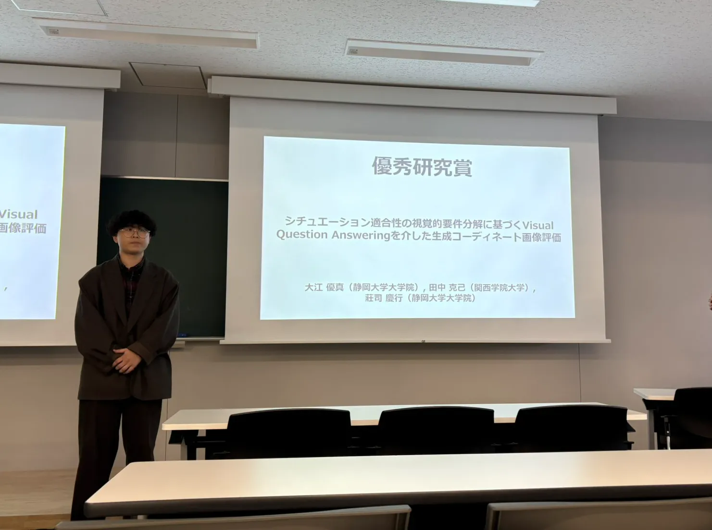

お久しぶりです。大江です。

2026年11月21日（土）に龍谷大学深草キャンパスにて開催された**ARG Webインテリジェンスとインタラクション研究会（ARG SIG-WI2）**にて、研究発表を行いました。

WI2研究会は、検索やデータベース、機械学習などのWebに関する幅広い技術を扱う研究会です。

今回は、着用シチュエーションから生成されたコーディネート画像を、シチュエーション適切さという観点で評価するためのフレームワークを提案した研究内容を発表しました。

ICMR、論文誌TODから続いている「シチュエーション×ファッション画像生成」の後続テーマであり、今度は生成結果を評価しようぜというモチベーションではじまった研究です。

研究会の中では、馴染みのあるレコメンド系の研究のほか、ソーシャルデータの分析やLLMのベンチマークといった普段なかなか聞けない多様なトピックが発表されていました。

また、大変ありがたいことに、**優秀研究賞**という素敵な賞をいただきました。

受賞報告は、表彰状が手元に届き次第改めて記事にする予定です。

発表された論文の書誌情報は以下の通りです。本論文は、後日J-STAGE経由でアクセスしていただけるようになります。

**シチュエーション適合性の視覚的要件分解に基づくVisual Question Answeringを介した生成コーディネート画像評価**, <u>大江 優真</u>, 田中 克己, 莊司 慶行, ARG 第22回Webインテリジェンスとインタラクション研究会（ARG WI2研究会）, 2026.